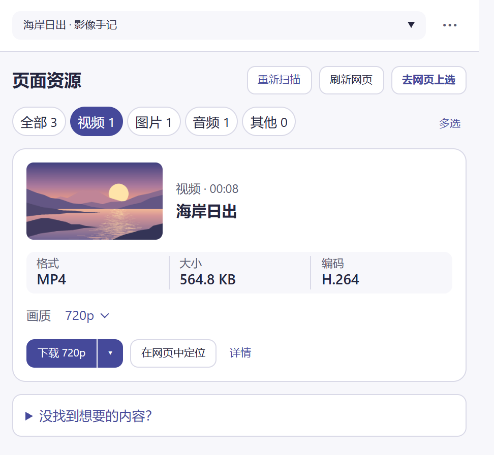

# Snag

Snag 是一款浏览器侧栏扩展。看网页时，可以直接在侧栏里找到视频、音频、图片和 PDF，预览后保存。视频的画面和声音分开传输时，Snag 会用内置的 FFmpeg 在本机合并。主要支持桌面版 Microsoft Edge，Google Chrome 共用同一个安装包。

**[下载最新版](https://github.com/syoosch/Snag/releases/latest)** · [使用指南](docs/usage.md) · [更新记录](CHANGELOG.md)

## 安装

1. 在[发布页](https://github.com/syoosch/Snag/releases/latest)的 **Assets** 下下载 `snag-1.0.2.zip`，解压到一个会长期保留的文件夹。
2. 在 Edge 地址栏输入 `edge://extensions`，打开 **开发人员模式**，点 **加载解压缩的扩展**。选择打开后能直接看到 `manifest.json` 的那层文件夹。
3. 欢迎页出现后，点 **同意并打开侧栏**。以后可以从浏览器右上角的 **扩展 → Snag** 打开。

Chrome 用户在 `chrome://extensions` 打开 **开发者模式**，点 **加载已解压的扩展程序**，选择同一个文件夹。[Edge 官方安装图解](https://learn.microsoft.com/zh-cn/microsoft-edge/extensions/getting-started/extension-sideloading) · [Chrome 官方安装图解](https://developer.chrome.com/docs/extensions/get-started/tutorial/hello-world?hl=zh-cn#load-unpacked)

## 下载第一个文件

打开目标网页并播放视频。侧栏会显示封面、文件格式和大小。有多个清晰度时，在 **画质** 中选择，再点 **下载**。想单独保存声音或画面，点下载按钮旁的 **▾**，选择 **仅下载音频** 或 **下载无声视频**。

- **找图片或音频**可以直接切换顶部分类。页面里有好几个视频时，点 **去网页上选**，再点你想要的那个。
- **对照原网页**可以点资源卡片的 **在网页中定位**。页面上的元素仍在时，Snag 会滚动到对应位置。
- **查看画质和大小**时，以下载按钮上的画质为准。带「约」的大小是估算值。网页上的播放器和可下载文件有时提供不同的清晰度。[画质、编码与常见问题](docs/usage.md)

## 隐私与源码

Snag 从正在浏览的网站及其媒体服务器获取文件，音画合并和音轨提取在电脑上完成。可选的外部下载器和消息转发默认关闭。各功能会访问哪里、发送哪些信息，以及临时文件何时清理，都列在[依赖与联网说明](lib/third-party-libraries.md)中。

Snag 基于 xifangczy 的猫抓 2.7.4 开发，沿用 GPL-3.0 许可证。感谢 xifangczy、Momo707577045 和上游贡献者。[上游项目](https://github.com/xifangczy/cat-catch/tree/2.7.4) · [许可证](LICENSE)

[反馈问题](https://github.com/syoosch/Snag/issues) · [开发与测试](CONTRIBUTING.md)
